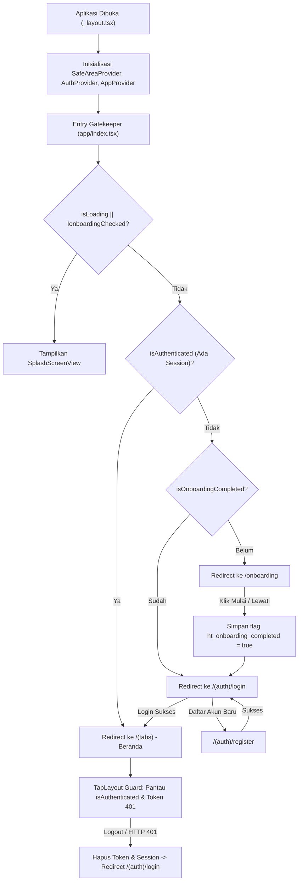
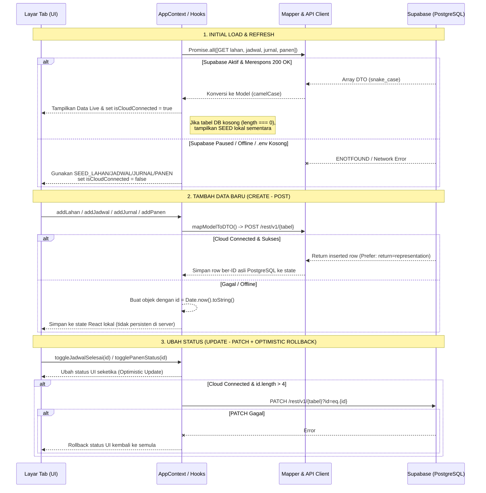

# Dokumentasi Lengkap Aplikasi HarianTani (`HarianTani-App`)

Dokumentasi ini menjelaskan arsitektur, alur pengguna (*user flow*), daftar fitur, logika bisnis & teknis, serta pengaruh dan alur integrasi database **Supabase (PostgreSQL + PostgREST + Supabase Auth)** pada aplikasi mobile **HarianTani-App**.

---

## 1. Gambaran Umum & Tech Stack

**HarianTani-App** adalah aplikasi mobile manajemen usaha tani cerdas (*Modern Agritech Precision*) yang dibangun menggunakan **Expo / React Native** dengan arsitektur **Cloud-First + Graceful Offline Fallback**.

### Teknologi Utama (`package.json` & `app.json`)
- **Framework**: Expo SDK `~58.0.25`, React Native `0.88.1`, React `19.3.0`, TypeScript `~6.0.3`
- **Routing & Navigasi**: `expo-router` (`~58.0.31`) berbasis file di folder `src/app/`
- **Keamanan & Penyimpanan**: `expo-secure-store` (Keychain/Keystore) dan `expo-crypto` (SHA-256 + UUID salt)
- **Sensor Perangkat Keras**: `expo-sensors` (`Accelerometer`) & `Vibration` API
- **Responsivitas Layar**: `react-native-safe-area-context` (`SafeAreaProvider` & `useSafeAreaInsets`)
- **Backend / Database**: Supabase REST API (`PostgREST /rest/v1/...` & `GoTrue Auth /auth/v1/...`)

### Struktur Direktori `src/`
```text
src/
├── app/                     # Rute & halaman layar (Expo Router)
│   ├── _layout.tsx          # RootLayout: SafeAreaProvider, AuthProvider, AppProvider
│   ├── index.tsx            # Entry gatekeeper: cek session & status onboarding
│   ├── onboarding.tsx       # Layar pengenalan aplikasi (first-time user)
│   ├── (auth)/              # Grup rute autentikasi
│   │   ├── _layout.tsx
│   │   ├── login.tsx        # Halaman masuk akun + tombol akun demo
│   │   └── register.tsx     # Halaman pendaftaran akun baru
│   └── (tabs)/              # Grup rute utama (Protected Tabs)
│       ├── _layout.tsx      # Tab navigator, Header, & Modal Uji REST API
│       ├── index.tsx        # Tab Beranda (Dashboard Lapangan)
│       ├── lahan.tsx        # Tab Inventaris Petak Lahan
│       ├── jadwal.tsx       # Tab Jadwal Perawatan
│       ├── jurnal.tsx       # Tab Jurnal Lapangan & Buku Kas
│       └── panen.tsx        # Tab Laporan Panen & Laba Rugi
├── components/              # Komponen UI reusable (AppCard, DarkSummaryCard, SensorDisplayCard, ErrorState, dll.)
├── constants/               # Tema warna, spacing, tipografi, & helper Layout (theme.ts, Colors.ts)
├── context/                 # Global state (AuthContext.tsx, AppContext.tsx)
├── hooks/                   # Custom hooks (useAccelerometer.ts, useHarvests.ts)
├── services/                # Network & Storage layer (api.ts, authStorage.ts)
├── types/                   # Definisi tipe DTO & Model Domain (api.ts)
└── utils/                   # Pure mapper DTO <-> Model (mapper.ts)
```

---

## 2. Alur Aplikasi (*End-to-End App Flow*)

Aplikasi menggunakan sistem penjagaan rute (*route guarding*) dan pengecekan status bertahap sejak aplikasi pertama kali dibuka hingga pengguna berinteraksi dengan data.



### Penjelasan Alur Langkah demi Langkah
1. **Inisialisasi Root (`src/app/_layout.tsx`)**:
   - Membungkus seluruh aplikasi dengan `SafeAreaProvider` -> `AuthProvider` -> `AppProvider`.
   - Secara paralel:
     - `AuthProvider` membaca ketersediaan `SecureStore` dan mengambil session tersimpan (`ht_auth_session`), lalu menyuntikkan JWT token ke interceptor jaringan (`setAuthToken`).
     - `AppProvider` langsung menjalankan `loadInitialData()` untuk memuat 4 tabel dari Supabase (atau beralih ke data lokal jika cloud tidak terjangkau).
2. **Gerbang Awal (`src/app/index.tsx`)**:
   - Menunggu proses baca sesi auth dan status onboarding (`ht_onboarding_completed`) selesai sambil menampilkan `SplashScreenView`.
   - Jika sudah login (`isAuthenticated === true`), langsung diarahkan ke `/(tabs)`.
   - Jika belum pernah menyelesaikan onboarding, diarahkan ke `/onboarding`.
   - Jika sudah onboarding tapi belum login, diarahkan ke `/(auth)/login`.
3. **Alur Onboarding (`src/app/onboarding.tsx`)**:
   - Menampilkan pratinjau alur kerja tani (*Tanam -> Pupuk & Air -> Panen*), kartu status lahan, serta 3 pilar fitur.
   - Menekan tombol **"Lewati"** atau tombol CTA akan menyimpan flag `ht_onboarding_completed = 'true'` via `setCompletedOnboarding()` dan mengarahkan ke halaman login/register.
4. **Alur Autentikasi (`(auth)/login.tsx` & `(auth)/register.tsx`)**:
   - **Login**: Pengguna dapat mengisi email & kata sandi atau menekan tombol **"Masuk Cepat Demo"** yang otomatis mengisi akun demo `budi.santoso@tani.id` / `PanenMelimpah2025`.
   - **Register**: Mendukung pemilihan peran (*Petani Mandiri* atau *Gapoktan / Kelompok*), validasi panjang kata sandi, konfirmasi kata sandi, dan persetujuan ketentuan.
5. **Alur Utama Dalam Tab (`(tabs)/_layout.tsx`)**:
   - Jika `isAuthenticated` menjadi `false` (karena pengguna logout atau server mengirim `401 Unauthorized`), `<Redirect href="/(auth)/login" />` langsung mengunci akses tab dan mengembalikan pengguna ke layar masuk.
   - Pengguna berpindah antar 5 layar utama melalui **Bottom Tab Bar**: **Beranda**, **Lahan**, **Jadwal**, **Jurnal**, dan **Panen**.

---

## 3. Daftar Fitur Aplikasi

### A. Keamanan, Autentikasi, & Onboarding
- **Splash Screen Informatif (`SplashScreenView.tsx`)**: Menampilkan status modul dan indikator enkripsi penyimpanan aman (*Agro-Vault Active*).
- **Onboarding Interaktif (`onboarding.tsx`)**: Memperkenalkan alur siklus tanam, simulasi status lahan, dan tombol lewati/mulai.
- **Login & Registrasi Terenkripsi**: Dilengkapi toggle lihat/sembunyi password, indikator status hardware keystore/keychain, simulasi biometrik/isi cepat akun demo, serta konfirmasi logout aman (menggunakan `Alert.alert` di mobile dan `window.confirm` di web).

### B. Beranda — Dashboard Lapangan (`src/app/(tabs)/index.tsx`)
- **Sapaan & Kartu Iklim Mikro**: Menampilkan tanggal lokal Indonesia (`id-ID`), kondisi cuaca, suhu (`weatherTemp`), kelembapan (`74%`), angin (`6 km/j`), serta advisori waktu optimal pemupukan daun (`15:30 - 17:00 WIB`).
- **Aksi Cepat**: Tombol pintas `+ Catat Jurnal` dan `+ Catat Panen` yang langsung menavigasi ke tab terkait.
- **3 Kartu Metrik Ringkas**:
  1. **Lahan Aktif**: Menampilkan jumlah petak terdaftar.
  2. **Tugas Hari Ini**: Menampilkan jumlah tugas tersisa vs selesai untuk tanggal hari ini.
  3. **Kas Usaha**: Menampilkan ringkasan surplus/defisit kas bersih dalam format ringkas (`Rp ...rb` / `Rp ...M`).
- **Sorotan Petak Utama**: Menampilkan lahan pertama (`lahanList[0]`), fase vegetatif, progress bar **HST (Hari Sesudah Tanam)** terhadap siklus 115 hari, sisa hari panen, dan grid parameter (Luas Efektif, Kebutuhan Air, Status Nutrisi).
- **Modul Sensor Perangkat (`SensorDisplayCard`)**: Menampilkan bacaan sensor accelerometer 3-sumbu real-time dan mendukung fitur **Shake-to-Refresh**.
- **Jadwal Hari Ini & Jurnal Terkini**: Pengguna dapat langsung mencentang jadwal hari ini selesai dari Beranda dan melihat 2 log jurnal terbaru.

### C. Lahan — Inventaris Petak Lahan (`src/app/(tabs)/lahan.tsx`)
- **Ringkasan Inventaris**: Total petak lahan, rata-rata umur tanaman (`avgHst` dalam HST), dan status irigasi.
- **Filter Komoditas**: Chip filter `Semua`, `Padi`, `Jagung`, dan `Palawija`.
- **Tambah Petak Baru**: Formulir inline untuk mengisi Nama Lahan, Luas, dan Komoditas (lengkap dengan preset cepat `Padi Ciherang`, `Jagung Manis`, `Cabai Rawit Merah`).
- **Daftar Kartu Lahan**: Menampilkan umur tanam masing-masing petak, tanggal tanam terformat, dan tombol sinkronisasi cloud.

### D. Jadwal — Jadwal Perawatan (`src/app/(tabs)/jadwal.tsx`)
- **Selector Kalender Mingguan Horizontal**: Strip tanggal Senin–Minggu dengan indikator titik event.
- **Widget Cuaca Lapang**: Informasi suhu `28°C` dan jam penyemprotan optimal (`< 09:30 WIB`).
- **Filter Ganda**: Filter status (`Semua`, `Hari Ini`, `Tertunda`, `Selesai`) dan filter berdasarkan petak lahan tertentu.
- **Manajemen Tugas**: Tambah jadwal perawatan (pilih petak lahan, waktu, kegiatan) serta checklist interaktif untuk mengubah status selesai/tertunda.

### E. Jurnal — Jurnal Lapangan & Buku Kas (`src/app/(tabs)/jurnal.tsx`)
- **Kartu Beban Operasional**: Menampilkan total pengeluaran bulan berjalan serta pemecahan estimasi biaya **Saprotan (59%)** dan **Tenaga Kerja (41%)**.
- **Filter Catatan**: Filter berdasarkan petak lahan dan toggle khusus transaksi yang memiliki biaya (`biaya > 0`).
- **Tambah Catatan Jurnal**: Formulir pilihan petak lahan, kategori kegiatan (`Bibit`, `Pupuk/Obat`, `BBM/Traktor`, `Upah Tenaga`, `Observasi`), isi observasi, dan nominal biaya (opsional/Rupiah).
- **Ekspor Buku Kas**: Ringkasan dialog rekap entri & total biaya untuk arsip usaha tani.

### F. Panen — Laporan Panen & Laba Rugi (`src/app/(tabs)/panen.tsx`)
- **Executive Profit & Loss Card (`DarkSummaryCard`)**: Menampilkan **Estimasi Keuntungan Bersih**, badge status profit/defisit beserta **Margin (%)**, **Pendapatan Bruto**, dan **Beban Biaya Operasional**.
- **Formulir Catat Panen dengan Kalkulator Live**: Memilih petak lahan (otomatis mengisi nama komoditas), satuan (`Kg`, `Ton`, `Kuintal`, `Ikat`), kuantitas, harga jual per satuan, dan pratinjau nilai total penjualan secara langsung (`liveTotal`).
- **Daftar Riwayat Panen (`FlatList` + `Pull-to-Refresh`)**: Menampilkan komoditas, bobot, harga per satuan, mitra pembeli, dan tombol ubah status verifikasi panen (*selesai / proses*).
- **Ekspor Laporan Keuangan**: Dialog ringkasan jumlah transaksi dan keuntungan bersih.

### G. Sensor Perangkat & Diagnostik API
- **Accelerometer & Shake-to-Refresh (`SensorDisplayCard.tsx`)**: Mengukur getaran/gerakan HP secara real-time, mengklasifikasikan kondisi stabil/bergerak/goncangan, dan memicu refresh dashboard saat HP digoyangkan. Dilengkapi tombol **Toggle Sensor** dan **Uji Goncangan** (untuk emulator/web).
- **Modal Status & Uji REST API (`(tabs)/_layout.tsx`)**: Tombol ikon awan/jaringan di header membuka panel untuk memeriksa status API aktif serta mensimulasikan 5 skenario jaringan: `Normal (200 OK)`, `Offline`, `Request Timeout (408)`, `Client Error (404)`, dan `Server Error (500)`.

### H. Desain Responsif & Safe Area Universal
- Menggunakan `SafeAreaProvider` di root dan `useSafeAreaInsets()` di Header, Bottom Tab Bar, Onboarding, Login, Register, Splash Screen, dan seluruh `ScrollView`/`FlatList`.
- Header membatasi lebar judul (`maxWidth: 190`, `flexShrink: 1`), modal dibatasi `maxHeight: '85%'` dengan `ScrollView`, nominal Rupiah besar memakai `adjustsFontSizeToFit`, dan grid kolom memakai `minWidth: 0` agar tidak pernah melewati batas layar tipe HP apa pun.

---

## 4. Penjelasan Logic Inti Aplikasi

### A. Logic Autentikasi & Keamanan Kredensial (`AuthContext.tsx` & `authStorage.ts`)
1. **Dual-Path Login (`login`)**:
   - **Jalur Utama (Cloud)**: Jika `.env` memiliki konfigurasi Supabase valid (`isSupabaseConfigured()`), aplikasi memanggil `apiLogin(email, password)` ke `/auth/v1/token?grant_type=password`. Jika berhasil, `access_token` dan profil user disimpan ke `SecureStore` (`ht_auth_session` & `access_token`) lalu disematkan ke header HTTP via `setAuthToken(token)`.
   - **Jalur Fallback Lokal**: Jika cloud login gagal (misalnya server paused/offline), aplikasi mengecek penyimpanan lokal terenkripsi (`verifyLocalCredentials`). Di dalamnya sudah tertanam akun demo default `budi.santoso@tani.id` (`PanenMelimpah2025`) agar aplikasi tetap dapat diuji secara offline.
2. **Hashing Lokal (`hashPassword`)**:
   - Kredensial lokal tidak pernah menyimpan password plaintext; password digabung dengan salt UUID acak (`${salt}:${password}`) dan di-hash menggunakan `Crypto.digestStringAsync(SHA256)`.
3. **Penyimpanan Storage (`authStorage.ts`)**:
   - Pada iOS/Android native, memakai `expo-secure-store` dengan opsi `SecureStore.WHEN_UNLOCKED`.
   - Pada Web atau lingkungan yang tidak mendukung `SecureStore`, otomatis beralih ke `memoryFallbackStore` di RAM.
4. **Auto-Logout pada `401 Unauthorized`**:
   - `AuthContext` mendaftarkan callback ke `setOnUnauthorized()` di `api.ts`. Setiap kali respons server mengembalikan status `401`, `api.ts` memicu callback tersebut untuk menghapus token memori, membersihkan `SecureStore`, dan mereset `session` menjadi `null`.

### B. Logic Network Layer & Klasifikasi Error (`src/services/api.ts`)
1. **Timeout dengan `AbortController` (`fetchWithTimeout`)**:
   - Setiap request HTTP memiliki batas waktu default `12000` ms (`DEFAULT_REQUEST_TIMEOUT_MS`), dan `6000` ms khusus `apiLogout`.
   - Juga mendukung `signal` eksternal (dipakai oleh `useFetchHarvests` untuk membatalkan fetch saat komponen *unmount* guna mencegah memory leak).
2. **Klasifikasi Error Terstruktur (`ApiError`)**:
   - `TIMEOUT` (`408`): Jika `AbortError` berasal dari timer internal.
   - `OFFLINE` (`0`): Jika pesan error mengandung `network request failed`, `failed to fetch`, `fetch failed`, `networkerror`, `internet`, `connection refused`, `enotfound`, `getaddrinfo`, atau `dns`.
   - `HTTP_ERROR` (`4xx / 5xx`): Memetakan kode `400`, `401`, `403`, `404`, `408`, `500`, `502`, `503`, `504` menjadi pesan bahasa Indonesia yang ramah pengguna, sekaligus menggabungkan pesan detail dari JSON server (`msg`, `message`, `error_description`, `hint`, `details`).
   - `UNKNOWN`: Kesalahan jaringan lain yang tidak terklasifikasi.

### C. Logic State Global & Error Handling UI (`AppContext.tsx`)
- **Graceful Fallback pada Startup & Refresh**:
  - `loadInitialData()` dan `refetchAll()` memanggil 4 endpoint secara paralel dengan `Promise.all`.
  - Jika server gagal dijangkau saat startup/refresh, `AppContext` **tidak memblokir pengguna** dengan layar error fatal; aplikasi mengisi state dengan data cadangan (`SEED_LAHAN`, `SEED_JADWAL`, `SEED_JURNAL`, `SEED_PANEN`), mengatur `isCloudConnected = false`, `apiStatus = 'idle'`, dan `error = null`.
- **Simulasi Error Terkendali (`simulateApiCondition`)**:
  - Ketika pengguna memilih skenario error (`offline`, `timeout`, `http_404`, `http_500`) di Modal Header, `isSimulationActive` diubah menjadi `true` dan `applyErrorState` mengisi `error`, `errorType`, dan `statusCode`.
  - Layar tab (`lahan.tsx`, `jadwal.tsx`, `jurnal.tsx`, `panen.tsx`, `index.tsx`) kemudian menampilkan komponen `<ErrorState />` layar penuh untuk demonstrasi penanganan error dan tombol **Retry**.

### D. Logic Kalkulasi Agronomi & Keuangan
- **Umur Tanaman / HST (`index.tsx` & `lahan.tsx`)**:
  $$\text{HST} = \left\lceil \frac{|\text{Sekarang} - \text{Tanggal Tanam}|}{86.400.000\text{ ms}} \right\rceil$$
  Pada Beranda, progres siklus tanam dibandingkan dengan konstanta `totalCycleDays = 115` hari, lalu dijepit (*clamp*) antara `10%` hingga `100%`.
- **Kas Usaha & Keuntungan Bersih (`index.tsx` & `panen.tsx`)**:
  $$\text{Total Pendapatan} = \sum (\text{jumlah/weightKg} \times \text{hargaJual})$$
  $$\text{Total Biaya} = \sum \text{jurnal.biaya}$$
  $$\text{Keuntungan Bersih / Kas Usaha} = \text{Total Pendapatan} - \text{Total Biaya}$$
  $$\text{Margin (\%)} = \text{clamp}\left(\text{round}_1\left(\frac{\text{Keuntungan Bersih}}{\text{Total Pendapatan}} \times 100\right),\, 0,\, 100\right)$$
- **Breakdown Beban Operasional (`jurnal.tsx`)**:
  $$\text{Saprotan} = \text{round}(\text{Total Biaya} \times 0.59), \quad \text{Tenaga Kerja} = \text{Total Biaya} - \text{Saprotan}$$

### E. Logic Sensor Accelerometer (`useAccelerometer.ts`)
1. Sensor membaca data percepatan $(x, y, z)$ setiap `100` ms (`SENSOR_UPDATE_INTERVAL_MS`).
2. Magnitudo total dihitung langsung dari angka mentah (*raw numbers*, tanpa pembulatan terlebih dahulu):
   $$a_{\text{total}} = \sqrt{x^2 + y^2 + z^2}$$
3. **Tabel Klasifikasi Status**:
   - $a_{\text{total}} \le 1.20\text{ g}$ -> `Kondisi Stabil`
   - $1.20\text{ g} < a_{\text{total}} \le 1.78\text{ g}$ -> `Pergerakan Terdeteksi`
   - $a_{\text{total}} > 1.78\text{ g}$ (`SHAKE_THRESHOLD`) -> `Goncangan Terdeteksi!`
4. **Throttling & Umpan Balik**:
   - Deteksi goncangan dibatasi jeda minimal `1000` ms (`COOLDOWN_MS`) agar tidak memicu refresh berulang kali dalam satu goncangan.
   - Saat terpicu: menggetarkan HP selama `400` ms (`Vibration.vibrate(400)` di Android/iOS), memanggil `onShakeRefresh` (mengubah temperatur cuaca demo dan memanggil `refetchAll()`), mencatat timestamp, menambah `shakeCount`, dan mereset status goncangan otomatis setelah `2500` ms (`SHAKE_RESET_MS`).

---

## 5. Pengaruh Database & Alur Interaksi Database (Supabase)

### A. Skema Database PostgreSQL (`supabase_schema.sql`)
Backend menggunakan 4 tabel utama di schema `public` Supabase:

| Nama Tabel | Kolom Utama | Tipe Data | Keterangan |
| :--- | :--- | :--- | :--- |
| `lahan` | `id`, `nama`, `luas`, `tanaman`, `tanggal_tanam`, `created_at` | `BIGINT` (PK Identity), `TEXT`, `DATE`, `TIMESTAMPTZ` | Menyimpan daftar petak lahan aktif |
| `jadwal_perawatan` | `id`, `id_lahan`, `tanggal`, `waktu`, `kegiatan`, `selesai`, `created_at` | `BIGINT` (PK Identity), `TEXT`, `DATE`, `BOOLEAN` | Menyimpan jadwal perawatan per lahan (`id_lahan` mereferensikan `lahan.id` secara logis) |
| `jurnal_lapangan` | `id`, `id_lahan`, `tanggal`, `catatan`, `biaya`, `created_at` | `BIGINT` (PK Identity), `TEXT`, `DATE`, `NUMERIC` | Menyimpan catatan observasi dan biaya pengeluaran |
| `laporan_panen` | `id`, `id_lahan`, `tanggal`, `jumlah`, `satuan`, `harga_jual`, `selesai`, `commodity`, `created_at` | `BIGINT` (PK Identity), `TEXT`, `DATE`, `NUMERIC`, `BOOLEAN` | Menyimpan hasil panen dan harga jual |

- **Row Level Security (RLS)**: Keempat tabel mengaktifkan RLS (`ENABLE ROW LEVEL SECURITY`) dengan policy akses publik (`FOR ALL TO anon, authenticated USING (true) WITH CHECK (true)`) untuk mendukung akses langsung menggunakan `anon` key maupun JWT user yang sudah login selama demonstrasi.

### B. Lapisan Data Transfer Object (DTO) & Mapper (`types/api.ts` & `utils/mapper.ts`)
Database PostgreSQL memakai penamaan **snake_case**, sedangkan UI React Native memakai **camelCase**. Semua pertukaran data melewati fungsi murni di `mapper.ts`:
- `lahan`: `tanggal_tanam` ↔ `tanggalTanam`, `created_at` ↔ `createdAt`, `id` dikonversi ke `string`.
- `jadwal_perawatan`: `id_lahan` ↔ `idLahan`.
- `jurnal_lapangan`: `id_lahan` ↔ `idLahan`, `biaya` dipastikan bertipe `number`.
- `laporan_panen`: `id_lahan` ↔ `idLahan`, `harga_jual` ↔ `hargaJual`, `selesai` / `is_completed` ↔ `isCompleted`.
- Khusus tab Panen (`useHarvests.ts`), model `Panen` dikonversi lebih lanjut oleh `mapPanenToHarvestItem` menjadi `HarvestItem` (`jumlah` -> `weightKg`, `tanggal` -> `date`).

### C. Alur Pengaruh Database terhadap Aplikasi



### D. Dampak Langsung Kondisi Database ke Perilaku Aplikasi

1. **Pengaruh Saat Database Supabase Aktif (Online)**:
   - Setiap penambahan data (`POST`) menggunakan header `Prefer: return=representation` sehingga Supabase langsung mengembalikan baris yang baru dibuat lengkap dengan `id` dari PostgreSQL dan `created_at`, lalu dimasukkan ke state aplikasi tanpa perlu fetch ulang seluruh tabel.
   - Perubahan checklist jadwal atau status panen (`PATCH`) langsung tersimpan permanen di database dan tetap bertahan ketika aplikasi ditutup lalu dibuka kembali.
   - Autentikasi menggunakan JWT asli dari Supabase Auth (`/auth/v1/token` & `/auth/v1/signup`).

2. **Pengaruh Saat Database Supabase Non-Aktif (*Paused* / Offline)**:
   - Aplikasi secara otomatis beroperasi dalam **Mode Lokal (`isCloudConnected = false`)** menggunakan data awal (`SEED_*`).
   - Pengguna tetap bisa menambah lahan, jadwal, jurnal, dan panen ke memori state React selama aplikasi terbuka, **namun perubahan tersebut bersifat sementara di RAM (state)** dan akan kembali ke data seed awal jika aplikasi ditutup total dan dibuka ulang.
   - Catatan pengecekan `id.length > 4` saat `PATCH`: Pada seed data (`id: '1'`, `'2'`), ID memiliki panjang ≤ 4 karakter sehingga tidak memicu request `PATCH` ke server, sedangkan ID timestamp lokal (`Date.now().toString()`, 13 digit) atau ID UUID panjang hanya dikirim ke server jika `isCloudConnected === true` (di `AppContext`) atau `isSupabaseConfigured()` (di `useUpdateHarvest`).

3. **Relasi & Efek Berantai Antar Fitur melalui Shared State (`AppContext`)**:
   - **Lahan → Semua Tab**: Menambah data di tabel `lahan` langsung memunculkan opsi petak baru di form pilihan lahan pada **Jadwal**, **Jurnal**, dan **Panen**, serta langsung memperbarui kartu jumlah *Lahan Aktif* di **Beranda**.
   - **Jurnal → Panen & Beranda**: Menambah pengeluaran di `jurnal_lapangan` langsung menambah *Total Biaya* yang otomatis mengurangi angka *Kas Usaha* di **Beranda** dan *Estimasi Keuntungan Bersih* serta *Margin (%)* di **Panen**.
   - **Panen → Beranda & Laba Rugi**: Tab Panen memakai hook `useAddHarvest` / `useUpdateHarvest` (yang memiliki state `harvests` lokal untuk FlatList) dan menyinkronkannya ke `AppContext` (`addPanen` & `togglePanenStatus`) melalui callback `onSuccessSync` dan `onStatusUpdated`. Dengan begitu, angka *Kas Usaha* di **Beranda** ikut terbarui ketika ada catatan panen baru pada sesi aktif.
   - **Catatan Pemeliharaan (*Developer Notes*)**:
     - Pada `AppContext.addPanen` setelah `useAddHarvest.onSuccessSync`, jika Supabase dalam kondisi aktif penuh, kedua fungsi (`useAddHarvest` dan `AppContext.addPanen`) sama-sama dapat memanggil `POST /rest/v1/laporan_panen` apabila `isCloudConnected === true`, sehingga perlu diperhatikan agar tidak terjadi duplikasi `POST` saat mode cloud aktif penuh.
     - Pada `supabase_schema.sql`, `id_lahan` bertipe `TEXT` tanpa *foreign key constraint* keras (`REFERENCES lahan(id)`), sehingga pengembang atau pengguna bebas melakukan uji tambah data maupun seed data tanpa terblokir oleh error integritas referensial saat ID masih berbentuk string lokal.
